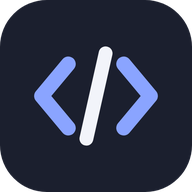
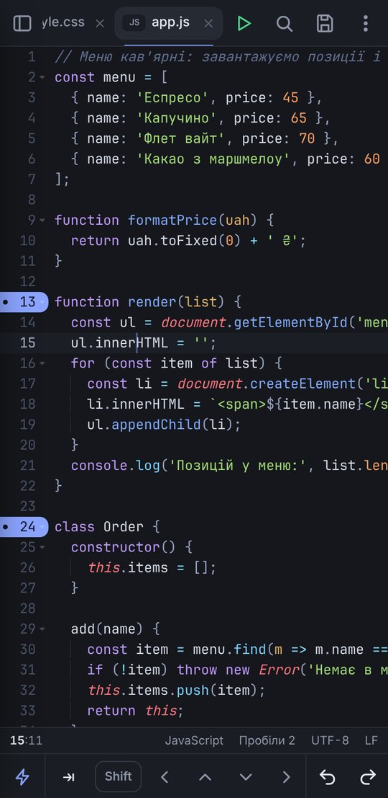
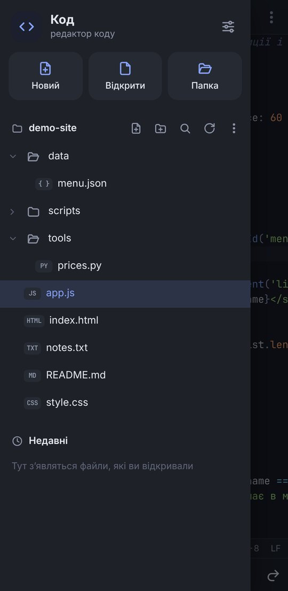
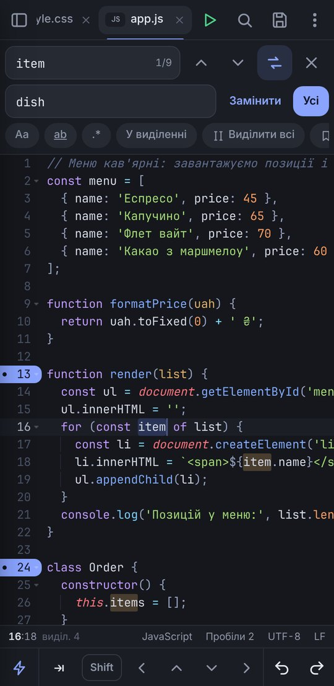
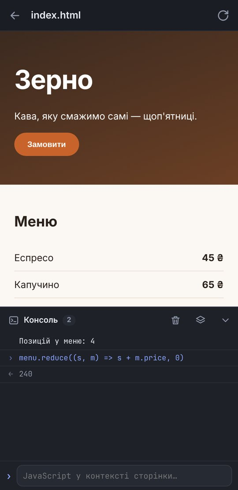
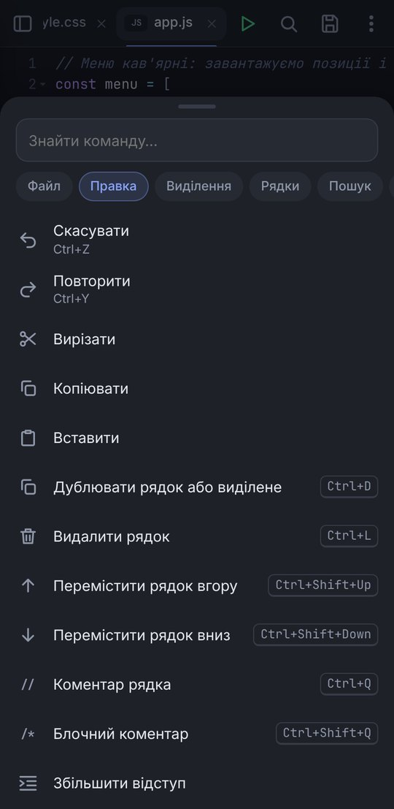
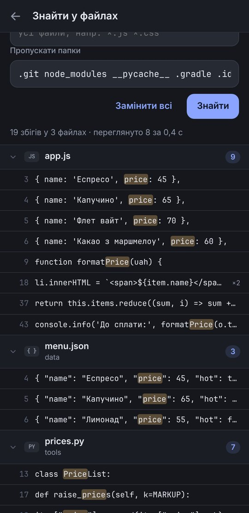
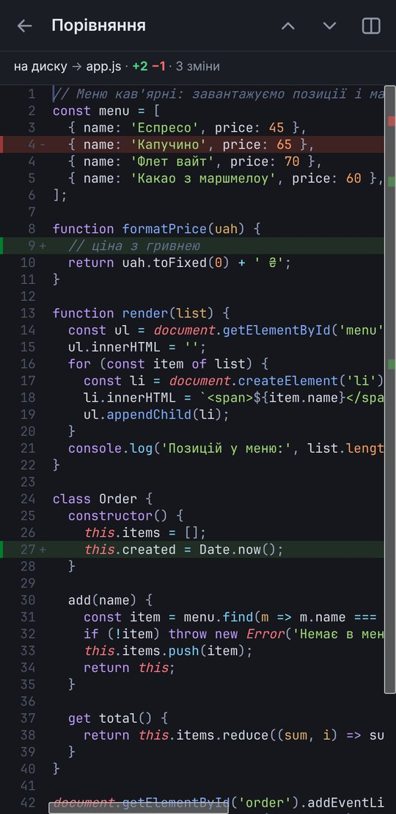
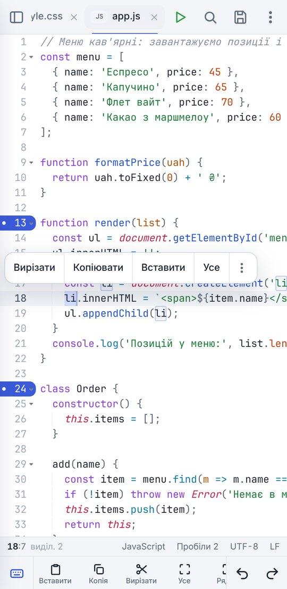
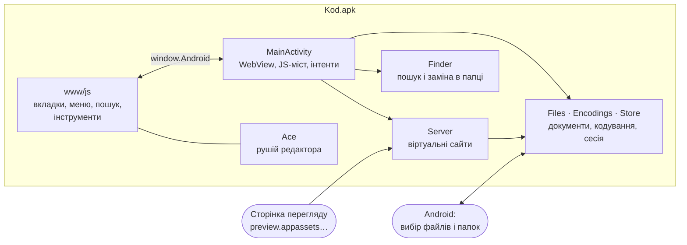

<div align="center">



# Код

**Редактор коду для Android у дусі Notepad++: вкладки, підсвітка понад 150 мов, пошук і заміна з regex,<br>кодування й кінці рядків, папка проєкту, запуск HTML і JavaScript з консоллю. Українською.**

[](#встановлення)
[](apk/)
[](apk/)
[](https://ace.c9.io)
[](#)

[**⬇ Завантажити APK**](https://github.com/hatogg/Kod/raw/main/apk/Kod-1.0.apk) &nbsp;·&nbsp;
[Посібник](docs/guide.md) &nbsp;·&nbsp;
[Комбінації клавіш](docs/guide.md#комбінації-клавіш) &nbsp;·&nbsp;
[Модулі коду](docs/README.md)

</div>

<br>

<table>
  <tr>
    <td align="center"><br><sub>Редактор</sub></td>
    <td align="center"><br><sub>Папка проєкту</sub></td>
    <td align="center"><br><sub>Пошук і заміна</sub></td>
    <td align="center"><br><sub>Запуск і консоль</sub></td>
  </tr>
  <tr>
    <td align="center"><br><sub>Меню команд</sub></td>
    <td align="center"><br><sub>Знайти у файлах</sub></td>
    <td align="center"><br><sub>Порівняння</sub></td>
    <td align="center"><br><sub>Світла тема</sub></td>
  </tr>
</table>

## Можливості

| Розділ | Що вміє |
|---|---|
| **Редактор** | Вкладки, підсвітка понад 150 мов, номери рядків, згортання блоків, кілька курсорів і блочне виділення, автодоповнення й сніпети, закриття дужок і тегів, підсвітка такого самого слова, показ усіх символів, напрямні відступів, перенесення рядків |
| **Пошук і заміна** | Із регістром, цілим словом, регулярними виразами (`$1`, `\n`), у виділенні; лічильник збігів, «Виділити всі» як курсори, закладки на рядках зі збігами, історія запитів |
| **Знайти у файлах** | По всій папці проєкту або у відкритих вкладках, з фільтром `*.js *.css` і пропуском `.git` чи `node_modules`; заміна в усіх файлах зі збереженням кодування кожного |
| **Кодування** | UTF-8 (з BOM і без), UTF-16 LE/BE, Windows-1251, KOI8-U, CP866, ISO-8859-x та ще 10. Визначаються самі, файл можна перечитати в іншому кодуванні або перетворити. Кінці рядків CRLF, LF і CR |
| **Рядки** | Сортування (за абеткою, числами, довжиною), видалення дублікатів і порожніх рядків, чистка пробілів, табуляції ↔ пробіли, об’єднати й розбити, вставити послідовність чисел у кожен курсор |
| **Навігація** | Перейти до рядка, закладки на полях, список функцій і класів (понад 30 мов), парна дужка, список помилок |
| **Перевірка** | Помилки й попередження в JavaScript, CSS, HTML, JSON, PHP, XML, YAML, Lua просто під час набору |
| **Запуск** | HTML і SVG — разом з CSS, скриптами й картинками з папки (навіть незбереженими); JavaScript — з консоллю, де можна виконувати вирази; Markdown — з підсвіткою коду |
| **Інструменти** | Форматування коду, JSON (красиво, в рядок, перевірити, сортувати ключі), порівняння з іншою вкладкою чи збереженою версією, макроси, Base64, URL, HTML-сутності, транслітерація, MD5 і SHA, статистика, друк і PDF |
| **Під телефон** | Рядок клавіш над клавіатурою: Tab, Shift, стрілки, дужки, свої символи. Кнопка ⚡ — дії з рядками. Панель над виділенням, масштаб щипком, закладка дотиком до номера рядка |
| **Файли** | Відкрити файл чи папку, створити, перейменувати, видалити; недавні файли; «Відкрити за допомогою» з файлового менеджера; незбережене відновлюється після перезапуску |

## Встановлення

1. Завантажте [**Kod-1.0.apk**](https://github.com/hatogg/Kod/raw/main/apk/Kod-1.0.apk) (файл лежить у папці [`apk/`](apk/)).
2. Відкрийте файл на телефоні й дозвольте встановлення з цього джерела.
3. Запустіть «Код». Щоб працювати з проєктом, натисніть ліву кнопку вгорі → **Папка** і виберіть папку.

Дозволів на сховище не потрібно: файли й папки відкриваються через системний вибір файлів Android, і доступ до них зберігається між запусками.

## Як у Notepad++

| Notepad++ | У «Коді» |
|---|---|
| Вкладки, «new 1» | Вкладки, «новий 1»; закрити, закрити інші, праворуч, перемістити |
| Пошук, заміна, «Знайти в файлах» | Панель пошуку та сторінка «Знайти у файлах» з регулярними виразами |
| Меню «Кодування» | Перечитати в кодуванні, перетворити на UTF-8 / UTF-8 BOM / Windows-1251 / …, кінці рядків |
| «Синтаксис» | Понад 150 мов, вибір вручну з пошуком |
| Закладки (Ctrl+F2, F2) | Ті самі клавіші, плюс копіювати, вирізати й видалити рядки із закладками |
| Операції з рядками | Окремий розділ меню «Рядки» |
| Макроси (Ctrl+Shift+R / P) | Запис, відтворення N разів або до кінця файлу, збережені макроси |
| Список функцій | Функції, класи, методи, заголовки Markdown |
| Порівняння (плагін) | Вбудоване: з іншою вкладкою, з диском, з буфером обміну |
| Запуск у браузері | Перегляд усередині застосунку з консоллю JavaScript |
| Сесія й резервні копії | Відкриті вкладки, курсори, згортки й незбережені зміни відновлюються |

Комбінації клавіш для фізичної клавіатури повторюють Notepad++: Ctrl+D — дублювати рядок, Ctrl+L — видалити, Ctrl+Q — коментар, Ctrl+H — заміна, F3 — далі. Повний список — у [посібнику](docs/guide.md#комбінації-клавіш).

## Як це влаштовано



Інтерфейс — вебсторінка в WebView з рушієм [Ace](https://ace.c9.io). Нативна частина на Java читає й пише файли через Storage Access Framework, визначає кодування, шукає в папках у фоновому потоці й роздає сторінки для запуску з віртуального домену. Сторінки, які ви запускаєте, працюють на окремому домені й не мають доступу до мосту з файлами.

## Модулі

| Модуль | Файли | Що робить |
|---|---|---|
| [Android-частина](docs/modules/android.md) | `MainActivity.java`, `FileShareProvider.java` | WebView, JS-міст `window.Android`, вибір файлів, інтенти «Відкрити за допомогою», друк, поширення |
| [Файли й кодування](docs/modules/files.md) | `Files.java`, `Encodings.java`, `Store.java`, `Finder.java`, `Server.java` | SAF-документи й дерево папки, визначення кодувань, сесія й резервні копії, пошук у папці, сервер перегляду |
| [Редактор](docs/modules/editor.md) | `tabs.js`, `edit.js`, `search.js`, `workspace.js` | Вкладки й сесія, збереження, операції з текстом, закладки, пошук і заміна, папка проєкту |
| [Інтерфейс](docs/modules/ui.md) | `ui.js`, `keys.js`, `commands.js`, `settings.js`, `themes.js`, `langs.js`, `app.css` | Аркуші й діалоги, рядок клавіш, меню команд і клавіші, налаштування, теми, мови |
| [Інструменти](docs/modules/tools.md) | `tools.js`, `format.js`, `hook.js` | Запуск і консоль, Markdown, порівняння, форматування, JSON, перетворення, хеші, друк |
| [Збирання і тести](docs/modules/build.md) | `build.sh`, `test/`, `mock.js`, `app/tools/` | APK без Gradle, тести кодувань на JVM, розробка інтерфейсу в браузері |

## Структура репозиторію

```
Kod/
├── apk/Kod-1.0.apk             готовий підписаний APK
├── build.sh                    збирання APK однією командою
├── test/
│   ├── run.sh                  тести кодувань і кінців рядків
│   └── EncodingsTest.java
├── app/
│   ├── AndroidManifest.xml     інтенти «Відкрити», «Поділитися»
│   ├── java/ua/kod/editor/     нативна частина
│   ├── assets/www/
│   │   ├── index.html
│   │   ├── css/app.css
│   │   ├── js/                 інтерфейс редактора (17 модулів)
│   │   ├── ace/                рушій Ace 1.44.0 (BSD)
│   │   └── fonts/              JetBrains Mono (OFL)
│   ├── res/                    іконка, тема
│   └── tools/                  підпис і вирівнювання APK
└── docs/                       посібник, модулі, скриншоти
```

## Збирання з коду

```bash
git clone https://github.com/hatogg/Kod.git
cd Kod
./test/run.sh     # тести кодувань
./build.sh        # → build/Kod-1.0.apk
```

Потрібні JDK 17+, Python 3, `zip`, `unzip`, `curl` і `git`; `aapt2`, D8 і `android.jar` завантажуються автоматично. Інтерфейс можна розробляти в Chrome: `app/assets/www/index.html` через будь-який локальний сервер — там працює імітація телефона з демо-проєктом. Подробиці — у [docs/modules/build.md](docs/modules/build.md).

## Приватність

Редактор нічого не надсилає. Дозвіл на інтернет є лише для сторінок, які ви самі запускаєте в перегляді (наприклад, якщо вони підключають бібліотеки з CDN). Сесія й резервні копії незбережених змін лежать у внутрішній пам’яті застосунку.

## Обмеження

- Запускаються HTML, SVG, JavaScript і Markdown. Інші мови (Python, C, Java…) підсвічуються, але не виконуються.
- Файли понад 32 МБ не відкриваються; від 6 МБ — без підсвітки й перевірки помилок.
- Форматування працює для C-подібних мов, HTML, CSS, XML і JSON. Якщо конструкція складна (наприклад, JSX), вирівнюються лише відступи.
- Скриншоти зняті в Chrome з імітацією Android-моста; на телефоні вигляд той самий, але системний рядок стану свій.

## Сторонні компоненти

- [Ace](https://github.com/ajaxorg/ace-builds) 1.44.0 — BSD-3-Clause, `app/assets/www/ace/LICENSE.txt`
- [JetBrains Mono](https://github.com/JetBrains/JetBrainsMono) — SIL Open Font License 1.1, `app/assets/www/fonts/OFL.txt`

<div align="center">
<sub>Код · Android 7.0+ · без реклами, без акаунтів, українською</sub>
</div>
