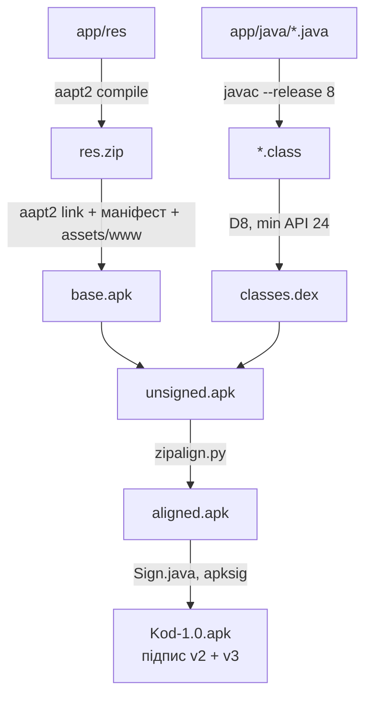

# Збирання і тести — `build.sh`, `test/`, `mock.js`, `app/tools/`

[← До списку модулів](../README.md)

APK збирається однією командою, без Android Studio, Gradle і встановленого Android SDK.

## Швидкий старт

```bash
./test/run.sh   # тести кодувань і кінців рядків на JVM
./build.sh      # → build/Kod-1.0.apk
```

**Потрібно:** JDK 17 або новіший, Python 3, `zip`, `unzip`, `curl`, `git`. Працює на Linux і macOS.

## Кроки збирання



| Крок | Інструмент | Що робить |
|---|---|---|
| 1 | `aapt2 compile` | Ресурси: адаптивна іконка (вектор), PNG для Android 7, теми для денного й нічного режиму |
| 2 | `aapt2 link` | Маніфест і ресурси в бінарному вигляді, редактор з `app/assets` (Ace, шрифти, інтерфейс), клас `R`; мінімальний API 24, цільовий 34 |
| 3 | `javac --release 8` | Компіляція з `android.jar` (API 34) у шляху класів |
| 4 | D8 | Байт-код → `classes.dex`, лямбди спрощуються для API 24 |
| 5 | `zipalign.py` | Вирівнювання нестиснених файлів на 4 байти |
| 6 | `Sign.java` | Підпис схемами v2 і v3 через `apksig` і перевірка підпису |

Інструменти (`bundletool` з `aapt2`, D8 і `apksig`; `android.jar`) завантажуються в `.tools/` під час першого збирання.

> Java-код не використовує нестатичні вкладені й анонімні класи: D8 із `bundletool` 1.17 падає на них, якщо компілювати новими JDK. Слухачі WebView — статичні вкладені класи з явним посиланням на Activity, решта — лямбди.

## Змінні середовища

| Змінна | За замовчуванням | Призначення |
|---|---|---|
| `KEYSTORE` | `keystore.p12` | Ключ підпису; якщо файлу немає — створюється новий |
| `STORE_PASS` | `android` | Пароль ключа |
| `VERSION_CODE`, `VERSION_NAME` | `1`, `1.0` | Версія застосунку і назва файлу |
| `TOOLS` | `.tools` | Папка завантажених інструментів |

## Підпис

APK у папці [`apk/`](../../apk/) підписано ключем автора, якого немає в репозиторії. Власна збірка підпишеться вашим ключем, і встановити її поверх версії з `apk/` не вийде — спершу видаліть попередню. Відкриті файли й налаштування при цьому зітруться, самі файли на телефоні — ні.

## Тести

`test/run.sh` компілює `Encodings.java` разом із `test/EncodingsTest.java` і запускає на звичайній JVM — 60 перевірок:

- визначення UTF-8, UTF-8 з BOM, UTF-16 LE/BE з BOM і без нього;
- Windows-1251, KOI8-U, KOI8-R, CP866 на українському й російському тексті, Windows-1252 на німецькому й французькому, короткі рядки;
- двійкові файли, неправильний UTF-8 (надлишкове кодування, сурогати), емодзі;
- кінці рядків LF, CRLF, CR, змішані; повний цикл «прочитати → записати» байт у байт для UTF-8 з CRLF і Windows-1251 з CRLF;
- підрахунок символів, що не вміщаються в кодування;
- наявність усіх 19 заявлених кодувань у Java.

## Розробка інтерфейсу в браузері

Без `window.Android` сторінка бере імітацію мосту з `mock.js`:

- демо-проєкт «Кав’ярня Зерно» в пам’яті: HTML, CSS, JavaScript, Markdown, JSON, Python, Shell і файл у Windows-1251 з CRLF;
- вибір файлу, папки й «Зберегти як» повертають файли з цього проєкту;
- «Знайти у файлах» і заміна працюють по ньому регулярними виразами JavaScript;
- сесія, налаштування й резервні копії — у `localStorage`;
- запуск HTML вбудовує CSS і скрипти прямо в `srcdoc`, бо віртуального домену в браузері немає.

```bash
cd app/assets/www && python3 -m http.server 8765
# відкрити http://localhost:8765 у Chrome з режимом пристрою
```

Через `file://` сторінка не запрацює: воркери перевірки помилок і модулі Ace завантажуються запитами. Скриншоти в README зняті саме так — у Chromium з емуляцією телефона (Playwright, 400×820, щільність 2).

## Залежності в репозиторії

| Що | Версія | Ліцензія | Де |
|---|---|---|---|
| Ace (`src-min-noconflict`) | 1.44.0 | BSD-3-Clause | `app/assets/www/ace/` |
| JetBrains Mono (Regular, Bold, woff2) | з [репозиторію](https://github.com/JetBrains/JetBrainsMono) | SIL OFL 1.1 | `app/assets/www/fonts/` |

Ace узято з репозиторію [`ajaxorg/ace-builds`](https://github.com/ajaxorg/ace-builds), тег `v1.44.0`; з нього прибрано лише прив’язки клавіш Vim, Emacs, Sublime і VS Code.
